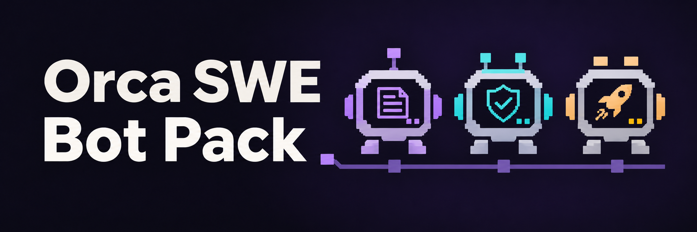

<div align="center">



**Six bot templates for software and product engineers working with AI agents.**

Start with one job. Each bot learns your repo, your workflow, and what it can do before you turn on its routines.

[Quick start](#quick-start) · [Browse the bots](#the-six-bots) · [Issue intake & Agile delivery](docs/issue-intake.md) · [Orca import and sharing](docs/orca-import.md)

</div>

---

## Why this pack?

Between a spec and a release, there is work that repeats. Someone has to find the approved contract, check the PR against it, update the docs, reuse the right worktree, and verify what actually shipped. The templates give those jobs a consistent home in Orca.

- **Bring your own workflow.** Start with [Stipulate](https://github.com/BRYANN2K/stipulate-skills), OpenSpec, Markdown specs, or your team's process. Each bot asks about the branches, CI, environments and approval signals it needs for its role.
- **Install one bot at a time.** Start with review, maintenance or another job you already do. Give the next bot the confirmed project profile so it can reuse those answers.
- **Review routines before they run.** Choose the scope and destination, try a historical case, and create selected routines paused. Set permissions separately for worker dispatch, PR publication, cleanup and deployment.

**Status.** The six Markdown templates and local preflight are available. Native Share Bot transfer and live delivery of automation events still need a recipient-side Orca test.

## Quick start

You need Orca with Bots enabled and an agent available on the chosen host. Python 3.10+ is required for the optional local preflight commands.

From the parent directory where you keep projects, clone the pack and add it to Orca. The private repository requires GitHub SSH access on that host.

```sh
git clone git@github.com:BRYANN2K/orca-swe-bot-pack.git && orca repo add --path "$PWD/orca-swe-bot-pack"
```

This adds the Git project to Orca. Continue with the role you want to install.

1. Pick a role from [the six bots](#the-six-bots). Create a bot in Orca and choose its host, agent and approval mode.
2. Paste the role's Markdown into its chat. Add this instruction and give it the repo and host when you know them.

   ```text
   Run this template's setup interview. Show me what you detect before saving
   a profile or adding automations.
   ```

3. Review the answers and confirm the profile. Have the bot try a historical PR or change in read-only mode. Open a new chat and verify that it recovers the role and repo scope.
4. Use the [preflight guide](docs/preflight.md) to preview the routines you want. Approve their creation paused, check the saved scopes and destinations, then enable the ones you want to run.

Sample profiles for [Stipulate](profiles/stipulate.json), [OpenSpec](profiles/openspec.json) and [Markdown + main](profiles/markdown-main.json) show which fields to confirm for a real repository.

## The six bots

| Template | First job to try |
| --- | --- |
| [Spec & Delivery](dist/spec-delivery.md) | Triage issues from GitHub, GitLab or Linear and turn one ready work item into an approved spec. |
| [PR Review & Docs](dist/pr-review-docs.md) | Review a PR against its criteria and identify the docs that belong in the same change. |
| [Repository Maintenance](dist/repo-maintenance.md) | Find a merged worktree eligible for cleanup and explain which local data must be kept. |
| [Security & Dependencies](dist/security-dependencies.md) | Match an advisory to the repo and deployed version, then prepare a narrowly scoped fix. |
| [Release & Environments](dist/release-environments.md) | Prepare a promotion dossier with the candidate, smoke tests, and rollback. |
| [Infrastructure Operations](dist/infrastructure-operations.md) | Summarize an existing deployment, drift or backup incident from the available evidence. |

## How the bots work together

On a project that uses one worktree per spec, a feature can move through the pack like this.

1. **Triage and plan.** Spec & Delivery detects new work in the configured trackers. A confirmed GitHub–Linear mirror can stay open in both. The team plans one work item within its cycle capacity or WIP limit.
2. **Agree on scope.** Spec & Delivery records the approved revision, dispatches the worker when authorized, and reuses the same worktree for corrections.
3. **Review the candidate.** PR Review & Docs checks the exact commit against the criteria and sends doc changes back to the worker in the same PR.
4. **Ship, close and learn.** Release & Environments ties evidence to the promoted candidate. Repository Maintenance checks the merged worktree before any authorized cleanup. Delivery follows up on the product outcome and flow at the team's agreed cadence.

Security and infra changes can enter the same flow. An advisory or a GitOps discrepancy starts with evidence and a proposed change. The worker takes it through the configured approval, PR and release steps. Each role can also return its result directly in chat when installed on its own.

[Automation recipes and catch-up behavior](docs/automations.md) · [Shared handoff example](profiles/handoff.example.json)

## Share templates through Orca

Use the Markdown files linked above to install locally. To distribute via **Share Bot**, prepare a clean reference bot for each role and review the contents before publishing its link. The [import guide](docs/orca-import.md) explains what Orca v1.4.266 can carry in a link, which schedules arrive paused, and which connectors and event targets the recipient configures.

## Develop and verify

Open a pull request into `main` for changes to the pack.

Edit the source role in `templates/` and regenerate the standalone file in `dist/`. These commands run locally.

```sh
python3 scripts/build.py
python3 scripts/build.py --check
python3 -m unittest discover -s scripts
```

The [preflight guide](docs/preflight.md) also covers the profile checker, handoff validation, routine previews, and the pilot acceptance checks.
